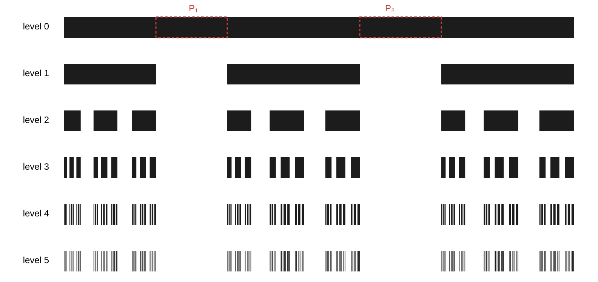
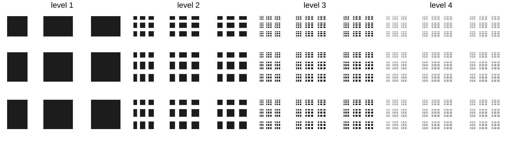

# A General Framework for Cantor-Trajectory Signal Watermarking, and Audio as a First Instance

**Author:** Jean Camille d'Ornano ("Doigtman")
**Version:** v1.1 (November 2026) — general framework document · [Version française](README_fr.md)

**Status.** This document is a theoretical framework and a research roadmap. Its validated results are the two audio prototypes described in Part II, Section 8 (v0.1 and v0.2), tested on a synthetic signal. Everything else — the general definitions, the detector architecture, the ecosystem idea, the contextual registry of Section 5.1 — is a design proposal, stated as such throughout.

**Licences.** This text is under CC BY-NC 4.0 (see `LICENSE-docs.md`); the code (`fractal_wm.py`) is under PolyForm Noncommercial 1.0.0 (see `LICENSE`). Commercial use of the text or the code requires a separate licence agreement with the author: jumelleat@gmail.com (or via GitHub: https://github.com/Doigtman).

**Scope of the licences.** They cover this text and this code as written works. The ideas themselves are published here, with a date, so that they can be cited; if you build on them, please cite this paper (Part II, Section 10).

**Copyright.** © 2026 Jean Camille d'Ornano.

---

## Preface: how to read this document

This document has two parts.

**Part I** defines a general mathematical object — a monochrome Cantor fractal, obtained by iterated ablation of a finite pattern of intervals — and a general architecture for using families of such objects to authenticate a signal: several independent ways to embed them, a two-layer detector (an abstract mathematical oracle, and a technical extraction step), and a flexible scheme for where the embedding parameters themselves are kept, including a registry of contextual metadata addressed by fractal addresses and protected by pseudo-watermarks (Section 5.1). It also records two structural observations that motivate longer-term extensions: a correspondence between the granularity of a discrete Cantor fractal and lossy compression, and a parallel between the self-similar structure this method relies on and the self-similar structure already present inside most compression codecs.

**Part II** is the original concept paper (previously circulated as draft v0.3), developing one explicit, minimal instance of this framework for audio: a single continuous one-parameter family of symmetric Cantor sets, three concrete embedding axes, and a working prototype with measured results — including the method's own current weaknesses. It is kept as the first worked example, not rewritten to match Part I's generality: a general framework is only worth publishing alongside a concrete case that has actually been built and tested, and that is what Part II provides. Version 1.1 adds the results of prototype v0.2, which cumulates three processes with three independent fractals each.

**A series, not a single paper.** This document is the first node of an extensible, tree-structured series of articles built around a notion the author calls the *hyperprompt*: a prompt that keeps track of the tree of prompts, results and further hyperprompts it comes from, and that also takes into account more strategic parameters (the direct-sum decomposition of Section 3, the symmetries of Section 6, and, at a more meta level, a graph-based language that refines itself). Later nodes will be added as branches; the watermarking framework below is one branch, written so that it can be read, cited and extended independently of the others.

**This article is a prompt.** This document is equivalent to a prompt: an agent can be asked to create the best possible prototype that fits the article, given a state of the art. Contributing to that state of the art, and/or having the state-of-the-art information referenced in the hyperprompt, is the boundary between prompt and hyperprompt; but let us keep in mind that it is a prompt, and executing it and referencing it is encouraged. Possibly in other hyperprompt trees; but favouring an already rich tree seems a sensible default (barring an exceptional wish for independence, which is a detail). The tree-structured language used (highly typed by a sort of vagueness indicator, meant to acquire texture…) is the subject of an annex article.

**Why publish it this way.** The framework in Part I is intentionally broader than anything that has been tested. The value of writing it down now, rather than waiting until more of it is implemented, is that its pieces can be developed separately (see Section 3 below), by the author or by others. They can also be brought into relation with each other, and in a hyperprompt setting they are meant to be: independence is a possibility the framework keeps open, not a separation it imposes.

---

# Part I — General framework

## 1. Monochrome Cantor fractals

**Definition (monochrome partition).** A monochrome partition of an interval [0,1] is a finite union of disjoint open subintervals of [0,1]. ("Monochrome" signals that this is a single, undifferentiated pattern — one "colour" — as opposed to a multi-colour or multi-valued marking scheme, which is left for future work.)

**Definition (ablation).** Given a monochrome partition P, the ablation of [0,1] by P removes P from [0,1], leaving a finite union of closed intervals. Ablation is then applied again, at the same relative scale (up to similarity), inside each remaining interval, and so on.

**Definition (monochrome Cantor fractal).** The limit of this process after infinitely many steps is a monochrome Cantor fractal. The classical triadic Cantor set is the case where P is the single centred open interval of relative length 1/3.

*Figure 1. Iterated ablation of [0,1] (levels 0 to 5) by a monochrome partition with two connected components, P = P₁ ∪ P₂ = (0.18, 0.32) ∪ (0.58, 0.74), outlined in red at level 0. At each level the same pattern is applied, rescaled, inside every remaining interval. The resulting fractal has similarity dimension d ≈ 0.753, the solution of 0.18^d + 2·0.26^d = 1.*

Three remarks:

- Everything above is stated on [0,1] but holds up to similarity (scaling) on any interval.
- No truly infinite fractal exists in any physical or digital signal. A usable object is always a monochrome Cantor fractal truncated at a finite depth, i.e. the ablation is iterated a finite number of times. Depth is a first-class parameter: it matters whenever the signal does not carry enough data to resolve deep levels.
- "Fractal" is used here for an object built by this iterated self-similar ablation; this is narrower than "fractal" in the broadest mathematical sense (which does not require self-repetition), but it is the sense used throughout this document.

### 1.1 Two useful families

**Centred fractals.** P is a single interval, centred in [0,1] (or in each sub-interval at every step). The only remaining degree of freedom is the interval's length, so the fractal is fully determined by a single real parameter — equivalently, by its Hausdorff dimension. This is the family developed in Part II: a continuous parameter gives a continuous family of fractals, and hence supports continuous trajectories through the family (Part II, Section 3.1). When P is allowed to be disconnected (several intervals removed per step) or connected but off-centre, there is more freedom than the dimension alone captures; this richer case is noted here but not developed in this document.

**Integer-subdivision fractals.** Subdivide [0,1] into n equal parts (equivalently: work in base n), and remove every point whose base-n expansion contains a digit from a chosen forbidden set D. This is a special case of the ablation process (definition above), the one where the closed complement contains isolated points, corresponding to the complement of P in ℕ.

One can speak of a sequence of integer-subdivision fractals indexed by increasing n, and of continuous families in the centred case, but the two notions do not combine: n is an integer, so there is no natural path between (say) n=3 and n=4, and varying n changes the rule, not a parameter of one rule.

In exchange, integer-subdivision fractals have two properties the centred family lacks:

- They can be drawn directly as a grid-aligned pattern (e.g. a black-and-white grid of cells), which maps naturally onto a pixel grid, a spectrogram cell grid, or a block of DFT bins at a chosen resolution n.
- Having many available (n, D) pairs, rather than one continuous parameter, gives a forger more superficially similar-looking candidates to confuse with the true one (Section 4.2).

A rational monochrome partition (all endpoints rational) is, by definition, an integer-subdivision pattern at some base n, and remains one at every integer multiple of n; an irrational partition is not. This distinction is used in Section 4.2.

### 1.2 Products and paths

The Cartesian product of two monochrome Cantor fractals is again (topologically) a monochrome-type Cantor fractal in two dimensions, with dimension equal to the sum of the two factors' dimensions (Part II, Section 2). This is what makes a 2D grid — a spectrogram, an image — a natural home for these objects.

*Figure 2. Product F × F of the fractal of Figure 1 with itself, at truncation levels 1 to 4 (black: kept cells). Such a 2D pattern can select time-frequency cells of a spectrogram or blocks of an image.*

A **path** of monochrome Cantor fractals is a family F(t) depending on a parameter t (typically time), such that nearby values of t give nearby fractals — in practice, nearby parameter values within a continuous family such as the centred family above. Continuity is a property of the path, not of any single fractal in it (Part II, Section 3.1). Integer-subdivision fractals do not form a natural continuous path in n, but a sequence of them (increasing n) can still be used deliberately, continuous or not (Section 4.2).

## 2. Embedding: many independent ways to graft a fractal onto a signal

A monochrome Cantor fractal, or a product of several, can be grafted onto many different aspects of a signal. Part II develops three such axes for audio in detail (spectral image, frequency-bin subsequence, time-window subsequence); this section states the general principle behind that list, so that it is read as one illustration of a general method rather than as the complete list.

The core observation is that a rich signal (audio, image, or video) offers many near-independent "places" to carry a perturbation: different transforms of the same data (raw samples, spectrogram, DFT coefficients, wavelet or DCT coefficients, pixel blocks), different sub-ranges within each (which frequency band, which time window, which image region), and different scales (coarse vs. fine). Each of these can separately carry a monochrome Cantor fractal or a path of them. Because they act on different aspects of the signal, their individual imperceptible perturbations do not have to accumulate into one perceptible one, provided each individual perturbation is kept small and they are not concentrated in the same place.

This has a direct practical consequence: **capacity is rarely the binding constraint.** The constraint is perceptibility — how much any one place can be perturbed without being noticed — not the number of places available, since the number of places is large and can itself be enlarged by combining transforms. When more capacity is needed than one embedding axis can provide without becoming audible or visible, the response is to spread the encoding across more axes and more locations, each perturbed a little, rather than to perturb one axis more heavily. (Prototype v0.2, Part II Section 8, cumulates three axes with three independent fractals each and shows that the perturbations do add up in audibility.)

A consequence for design: embedding axes can be made to interact — e.g. which part of the frequency axis is used can itself depend on a value decoded from the time axis — and a detector can be designed to move between axes depending on context (Section 4.3) rather than checking a single fixed axis.

## 3. Independence and recombination (the "direct sum" structure)

Several parts of this framework can be developed independently of each other and recombined later, because they depend on each other only through well-defined interfaces:

- The abstract mathematical detector (Section 4.1) depends only on the definition of monochrome Cantor fractals and on a notion of distance or distinguishability between them. It does not depend on which embedding axis is used, or on any detail of audio, image, or video signals.
- Work on a new embedding axis (Section 2) depends only on producing, from a monochrome Cantor fractal, a perturbation of some representation of the signal, and extracting an estimate of that fractal back from a (possibly compressed, possibly tampered) version of the signal. It does not depend on which other axes exist.
- Work on the hidden map (Section 5) — how embedding parameters themselves are recorded — depends only on there being some embedding axis available to carry it, not on which one.
- The compression-ecosystem extension (Section 6.2) depends only on the self-similar structure of the fractals and of compression codecs, not on the rest of the scheme being finished.

This independence means the pieces can be worked on separately — by the author, by collaborators, or by later readers — and combined once each is in a usable state, similarly to how independent subproblems can be solved separately and then assembled, provided the interfaces between them (what each part produces and consumes) stay fixed. It is also why this document is published now, as a framework with one worked instance, rather than withheld until every piece is built: the parts that are not yet built do not block citation of, or further work on, the parts that are.

## 4. The detector

### 4.1 The abstract (mathematical) detector

At the most general level, a detector is specified as a mathematical problem, independent of any implementation: given a monochrome Cantor fractal — truncated at some finite depth, and possibly perturbed by an operation such as compression — recover the generating monochrome partition, or decide among a given set of candidate partitions which one it came from.

This is stated here as an **oracle**: a well-defined mathematical problem, not (yet) a concrete algorithm. Studied in full generality, it raises hard questions — about which perturbations preserve enough information to allow recovery, about resolution limits, and plausibly about cases with no effective algorithm at all. Part II, Section 8's detector is one concrete, limited realization of this oracle, restricted to the single-parameter centred family and to a correlation-based estimator; Section 4.2 below records a specific limitation of any such detector.

### 4.2 A resolution limit: the granularity correspondence

Consider two monochrome partitions whose endpoints differ by less than the resolution reached at a given truncation depth (for instance two integer-subdivision patterns whose removed blocks have nearly the same position and size once the signal's granularity is taken into account). At that depth, and under a given perturbation, the resulting fractals can be indistinguishable in practice, even though they are different mathematical objects; refining the depth or the base eventually separates them.

This gives a precise sense in which zooming out on a fine discrete fractal "compresses" it into a coarser one, in parallel with how a signal is compressed. It also means the abstract detector of Section 4.1 has an intrinsic resolution limit: for a given truncation depth and perturbation level, there exist pairs of distinct monochrome partitions whose resulting fractals are not distinguishable by any detector, no matter how the detector is built. This is a property of the mathematical objects involved, not a flaw in a particular implementation, and it has a practical use: a detector or a defender can deliberately present a forger with several integer-subdivision candidates that are close at low resolution, so that an attacker who matches only the coarse appearance is still distinguishable at a resolution the attacker did not anticipate (Section 4.3; Part II, Section 5's "continuity trap" is a special case of this idea, restricted to continuous paths).

### 4.3 The technical detector

Separately from the abstract problem above, a technical detector is the implementation that locates, within an actual signal file, where and how the embedding was carried out, and extracts the raw data the abstract detector then operates on. This is an engineering problem (where was it placed, how is it recovered after the file format or compression has altered the data) rather than a theoretical one. Because it must know which embedding axis or axes were used, it is coupled to Section 2's choices — unlike the abstract detector, which is not. A technical detector for a scheme using several axes can be designed to move between axes depending on context rather than checking one fixed axis, which is also what makes the coarse/fine candidate trick above effective: the forger does not know, in advance, which axis or resolution will be checked.

## 5. Where the embedding parameters live: a spectrum, not a binary choice

The parameters needed to regenerate and check an embedding (which axes were used, which fractals, which paths) can be kept in different ways, trading off imperceptibility against the need to store something outside the signal:

- **External key only.** The signal is altered minimally; the parameters needed to reproduce the exact expected pattern are kept by the verifying party as a secret key (as in Part II's K). This allows an arbitrarily large amount of information to be encoded in the key itself — "as many digits as needed" — at the cost of requiring the key to be stored and managed (storage is the main cost; whether more digits strengthen the tests in practice is to be measured), and of every verification needing access to it (or to a derived, lower-tier version of it, as in Part II, Section 4).
- **Self-contained (re-injected) map.** The same parameters are themselves encoded as an additional monochrome Cantor fractal (or several), embedded inaudibly or imperceptibly inside the signal, so that nothing need be stored externally beyond whatever minimal secret is needed to locate and decode that map. This avoids external storage, at the cost of needing additional, carefully placed capacity within the signal (Section 2).
- **Hybrid.** Any mixture: some parameters external, some re-injected; different axes used for the map itself than for the primary signature, exploiting the same "many independent places, each perturbed a little" principle as Section 2.
- **External contextual metadata** (Section 5.1): a registry keeps metadata attached to a fractal part of the signal's own structures, addressed by fractal addresses and protected by pseudo-watermarks, with no change to the signal.

No single point on this spectrum is claimed to be best; which is appropriate depends on how much capacity a given signal offers (Section 2) and on operational constraints (what a verifying organization is willing to store).

### 5.1 External Contextual Metadata and Pseudo-Watermarking (Proposed Extension)

**Status.** Conceptual extension. It does not require modifying the signal. No implementation or experiment exists at the date of writing.

**Idea.** Instead of embedding everything in the signal, a registry keeps *only some metadata associated with the signal*. These metadata are attached to a **fractal part of the base data** (a thin, key-chosen subset of structures of the signal: spectrogram regions, DCT blocks, wavelet components, spectral trajectories). The scheme is

    Work + External registry + Matching procedure

rather than *Work + Embedded signature*.

**Compression resistance.** The metadata are never stored in the media, so they cannot be damaged by compression. What must survive is the *identifiability of the structure* they are attached to: it must be **reconstructible after compression, within a stated error bound**. For an integer-subdivision fractal in base n, a structure that survives only down to depth L_c is located up to one cell of depth L_c, i.e. with position error below n^(−L_c). Two mechanisms: *direct persistence* (the structure is still recognisable, and the metadata are recovered directly) and *contextual persistence* (the exact structure is lost, its surroundings are identifiable, and the registry re-associates the metadata).

**The forger does not know which part.** The fractal part is chosen by the key. A forger sees a signal, not the registry, and does not know which of its structures carry metadata.

**Pseudo-watermarking.** Even if the forger knew which part it is, that part can be *pseudo-watermarked* as many times as desired. A pseudo-watermark is a fractal scrambling associated, **in the registry**, with the metadata part: it is computed like a watermark (from the key and the part) but is never embedded in the signal, so it costs nothing in perceptibility. Pseudo-watermarks can interact with each other and with real watermarks (for instance, a parameter of a real embedding can depend on the value of a pseudo-watermark), so that forging one layer requires knowing the others. This is a design claim: its actual security has not been analysed.

**Fractal address.** Cantor structures also serve as an *addressing system*. Take a truncated fractal of depth L in base n with allowed digit set A. Each closed interval of depth L is labelled by the word d₁d₂…d_L of digits of A (its base-n expansion 0.d₁…d_L); a point of the fractal is labelled by its expansion, finite or infinite; isolated points keep their own expansion. Truncating at a smaller depth keeps a prefix, so addresses are **hierarchical**: a coarse address is a prefix of every finer address it contains. For the continuous centred family, the address is the left/right word in {0,1}^L. Metadata are attached to addresses:

    Fractal address → Metadata        (not Pixel → Metadata, nor Sample → Metadata)

Cantor structures then become hierarchical coordinate systems, naturally compatible with the direct-sum decomposition of Section 3. Verification becomes a matching operation — *observed structure ↔ registered structure* — performed at the depth the compressed signal still resolves.

**Position in the framework.** Storage spectrum: 1. direct embedding; 2. self-contained re-injected map; 3. external key; 4. external contextual metadata with pseudo-watermarking. The fourth mode minimises changes to the signal, at the cost of a stronger dependence on an external registry.

## 6. Two structural observations (longer-term directions)

These are noted explicitly because they recur across the framework and are judged likely to matter for later work, even though neither is developed into a concrete method here.

### 6.1 The granularity correspondence (cross-reference)

Section 4.2 above: within this framework, "coarser look" and "compressed look" are closely related for integer-subdivision fractals, which is a structural fact about the objects themselves, independent of any specific signal or codec.

### 6.2 Compression and watermarking share a self-similar structure

Many lossy compression codecs already exploit self-similar structure internally (e.g. transform coding across scales). This framework also uses self-similar (fractal) structure, for a different purpose (authentication rather than compression). Two independently motivated techniques relying on structurally similar mathematics is the kind of correspondence worth treating as a design opportunity rather than a coincidence: if this watermarking approach were used widely enough, compression codecs could in principle be designed to expose, align with, or make room for this structure, so that compression stops being merely an obstacle the signature must survive and becomes a system that helps carry or protect it. This remains a long-term, ecosystem-level direction, not a near-term requirement, and is unchanged in substance from Part II, Section 6's mention of it — stated here at the level of the general framework rather than the audio instance.

## 7. Status and relation to Part II

**On the limitations reported in Part II.** The weaknesses found by the prototype (Part II, Section 8, findings 1 to 4) come from the deliberate simplicity of the prototype and from the illustrative protocols used to test it: a single one-parameter family, a naive 15-bit fingerprint, one embedding axis, a basic detector. They are not, as far as is known at this date, limitations of the framework itself, and the author expects them to be removable by standard refinements: error-tolerant fingerprints, several interdependent axes, a signal-dependent derivation of the trajectory, a richer family of fractals. The author's assessment is that this is to be expected: these limitations should be removable, because hidden, archivable data (the external key and parameter map of Section 5) give room to remove the limitations tied to the prototype's simplicity ("as many digits as one wants", the main cost being storage) and, more speculatively, so does the multiplicity of independent "places" of Section 2. This remains an expectation, not a result: none of these refinements has been implemented or measured yet, and prototype v0.2 (Part II, Section 8) shows that cumulating many fractals trades security for audibility.

Nothing in this Part I has been implemented or tested beyond what Part II already reports. Part I is a framework intended to let independent pieces (Section 3) be developed and tested separately over time, under a shared vocabulary and a shared citation. Part II, kept below as originally written (previously circulated as draft v0.3) and completed by the v0.2 results, is the first and so far only instance built and measured within this framework: the single-parameter centred family, three embedding axes for audio, and working prototypes with both successes and open failures honestly reported.

---

# Part II — Audio instance: Continuous Cantor-Trajectory Watermarking for Audio Authentication

*(This part is the concept paper previously circulated as draft v0.3. It is reproduced here as the worked example of the general framework in Part I; its numbering restarts at Section 1 for readability, and its own Section 10 gives the citation for this specific instance. Minor cross-references now point to Part I where the general statement lives.)*

## 1. Summary

This document proposes a method for authenticating audio recordings (extensible to image and video) by embedding a signature whose key is not a pattern but a continuous trajectory of fractal dimensions through a family of Cantor sets. This is the centred family of Part I, Section 1.1, used as a continuous path (Part I, Section 1.2).

Three ideas are combined:

1. **Fractal dimension as the secret.** The embedded code is carried by the dimensions of Cantor-type sets, not by their visible patterns.
2. **Continuity as an integrity test.** The dimension varies continuously in time. A local edit breaks the trajectory in a measurable way.
3. **Signal-dependent keying.** The trajectory is derived from both a secret key and the content of the signal, so that no two recordings share the same code grid.

To the best of the author's knowledge, static fractal watermarking of images exists (e.g. Bas, Chassery, Davoine, 1998 [1]), block-wise tamper localisation for images has been studied (e.g. Fridrich, 1998 [2]), and fractal watermarks for deepfake localisation in images were proposed in 2025 [3]. A time-continuous trajectory through a Cantor family, with dimension as the key and continuity as the tamper test, has not been described in the literature that the author could find. A prior-art search was done; it does not prove absence.

## 2. Background: generalized Cantor sets and dimension

Take an integer base n and a set D of forbidden digits. Keep all numbers in [0,1] whose base-n expansion avoids D. With k = |D| digits removed, n − k remain at each level, and the Hausdorff (similarity) dimension is [4]

    d = log(n − k) / log(n)

Example: base 15 with digits {8, 7, 4, 5} removed leaves 11 digits, so d₁ = log 11 / log 15. Base 8 with digits {7, 2, 3} removed leaves 5, so d₂ = log 5 / log 8.

For a Cartesian product F₁ × F₂ (a 2D grid, suited to images and spectrograms), the dimensions add: d = d₁ + d₂. Combining several simultaneous codes therefore amounts to summing their dimensions.

**Key observation.** An attacker who sees the pattern does not directly see (n, D). What is recoverable from the signal is, at best, an estimate of dimensions. The dimensions are the encoded datum.

### 2.1 From discrete to continuous families

Discrete (n, D) pairs are isolated points in parameter space: no notion of "nearby", hence no trajectory and no continuity test.

A simple continuous family is the symmetric Cantor set with contraction ratio r in (0, 1/2): at each step keep two pieces, each scaled by r. Its dimension is

    d(r) = log 2 / log(1 / r)

which varies continuously and monotonically with r. More general families (several ratios, asymmetric pieces, products) follow the same idea.

*Note.* The single-parameter linear family r → d(r) above is the simplest illustrative case, not a constraint. The continuous coding function can be made arbitrarily more complex (multi-parameter, non-linear, higher-dimensional) once the basic scheme is validated; this is a direction for later refinement, not a requirement for a first working version.

## 3. The method

### 3.1 Trajectory

Let F_i(t) be Cantor sets (2D for spectrogram-based coding) whose parameters depend continuously on time t. The signature is the vector-valued function

    S(t) = ( dim F₁(t), dim F₂(t), …, dim F_m(t) )

Continuity is required of the trajectory S(t), not of the sets themselves. Sets at nearby times are close; the dimension path is continuous.

### 3.2 Three embedding axes (combinable)

| Axis | Object | Operation |
|---|---|---|
| A. Spectral image | Spectrogram seen as a 2D image | Product of two Cantor sets selects which time-frequency blocks are perturbed |
| B. Frequency | The N DFT components of one analysis window | 1D Cantor-style selection over frequency bins |
| C. Time | Successive analysis windows | Same logic along the time axis |

Each axis can carry its own trajectory. The axes can interact with each other and with the source signal. For a 44.1 kHz recording, a 2048- or 4096-sample window gives 1024 to 2048 bins per window, and a recording contains hundreds to thousands of windows, so the N × T grid has ample room for several Cantor subdivision levels. These three axes are one illustration of the general embedding principle of Part I, Section 2; further axes (e.g. a hidden re-injected parameter map, Part I, Section 5) are not yet implemented.

### 3.3 Signal-dependent keying

If the code depended only on the secret key K, the same recording would always produce the same grid, and an observer collecting many signed recordings could look for regularities (analogous to reusing a keystream).

Instead, derive the trajectory parameters from K and a fingerprint of the signal:

    seed = PRF(K, fingerprint(signal))

Open constraint: the fingerprint must survive compression, otherwise the verifier cannot recompute it. It should be built from coarse, compression-robust features (for example a low-resolution spectral envelope), and this robustness must be measured.

### 3.4 Compression resistance

The design goal is self-similarity across scales: since the Cantor structure repeats at every level, information coarse enough to survive lossy coding should still be present. The method does not target a specific codec. This is a hypothesis; Section 9 describes how to test it. See also Part I, Section 6.2 for the longer-term, ecosystem-level version of this idea.

## 4. Verification tiers

| Tier | Access | Can establish | Cost |
|---|---|---|---|
| 1. Public | None | Gross anomalies only (e.g. broken continuity) | Low |
| 2. Derived | Public verification parameters | Part of the structure (e.g. spectrogram-level coding) | Medium |
| 3. Full | Complete secret key | Exact expected trajectory on all axes, compared to the measured one | Higher |

Tier 1 is intended for the general public, at lower assurance. Additional inaudible metadata (for example a hash of the original signal) may serve tier 3. This corresponds to the external-key end of the spectrum in Part I, Section 5.

## 5. Threat model and "the continuity trap"

An attacker may try to edit a recording and then imitate continuity so that cheap verifiers pass it. The danger is real: a public tier-1 verifier that only checks smoothness tells the forger exactly what to fake.

Two strategies were considered:

- **A. Mask the continuity test:** public verifiers never test smoothness directly, but something derived from it. This protects, but relies on obscurity and is fragile once enough examples are analysed.
- **B. The continuity trap (retained as the priority):** let continuity stay testable, but design the dependence between coding parameters and signal content so that the effort to fake a plausible continuity necessarily breaks the true dependence on the signal, which a higher tier can detect. The harder the forger works to look smooth from outside, the further they drift from the signal-bound code.

Design principle: when choosing how parameters are derived from the signal, prefer derivations that are sensitive to exactly the kind of modification a continuity-faker would make, rather than derivations that are robust to any change. The derivation function is itself the trap. This is a special case, restricted to continuous paths in the centred family, of the general resolution-limit argument in Part I, Section 4.2.

Both strategies are kept available; B is developed first.

## 6. Future extensions (not required for a first version)

- **Cross-axis dependence.** The three embedding axes (spectral image, frequency, time) are currently described as independently combinable. A natural extension is to make them interdependent (e.g. the time-axis trajectory partly determines the allowed frequency-axis parameters), which would increase the cost of forging one axis without the others. Not necessary for an initial working version; flagged here as a strengthening step once the base scheme works.
- **Leveraging compression internals.** See Part I, Section 6.2.
- **Generalization to images and video.** The principles of this paper (Cantor-set dimension as key, continuous trajectories of dimension, signal-dependent keying, the continuity trap) are intended to apply to still images and to video, and the present document is meant to cover that scope.
  - *Still images.* Axis A applies directly: a product of two Cantor sets selects pixel blocks, or DCT or wavelet coefficients, in place of spectrogram cells, and the trajectory runs along a block or scan order in place of time.
  - *Video.* The image method is applied to each frame or group of frames, with a trajectory running across frames; the audio track can carry its own trajectory, and the two can be cross-checked.
  - *Why audio is the reference case.* A spectrogram is already a 2D image, so the image method is contained in Axis A; audio adds a time axis whose continuity must be both preserved and tested. An image-only or video-only application is therefore a special case or a direct extension of the method described here.
  - *Status.* No image or video experiment has been run; this extension is a design claim to be validated, like the rest of the paper.

## 7. Limitations and open problems

- **Imperceptibility is only partly tested.** SNR is measured (Section 8), but no listening test or perceptual metric has been run; modifying DFT components along a Cantor selection may be audible.
- **Fingerprint robustness** (Section 3.3) must be measured across codecs and bitrates.
- **Estimating dimensions from a compressed signal is statistically delicate;** finite-resolution estimates of fractal dimension are noisy. The achievable precision decides how much information the trajectory can carry.
- **Staccato and silence.** The continuity of the recording itself is interrupted by silences; the continuity of the code must be maintained independently across them.
- **Security analysis is informal.** No formal adversary model, key-recovery bounds or false-positive rates are given yet.
- **Interactions between axes** may add robustness or add attack surface; this is unexplored.

## 8. Prototypes: first results

### 8.1 Prototype v0.1 (one process, one fractal)

`fractal_wm.py` v0.1 implemented a minimal version: STFT (2048/512), a smooth key-derived trajectory r(t) in [0.30, 0.44] (dimension 0.58 to 0.84), a level-5 symmetric Cantor mask over 300 Hz to 12 kHz scaling bin magnitudes by 1 ± delta, and a correlation detector. The results below are kept as originally measured; the code in this repository is v0.2 (Section 8.2).

Conditions, stated plainly: a 24 s synthetic signal (pink noise plus harmonic tones), one key, one run per setting. No real music or speech, no listening test, no forger experiment. Treat the numbers as an existence proof of the mechanism, not as performance claims.

Tier-3 detection score (mean z-score against wrong trajectories; about 0 means not detected):

| delta | SNR (dB) | clean | MP3 128k | MP3 64k | AAC 96k | Opus 64k |
|---|---|---|---|---|---|---|
| 0.05 | 32.1 | 2.3 | 2.2 | 2.3 | 2.0 | 2.2 |
| 0.10 | 26.1 | 4.6 | 4.6 | 4.6 | 4.0 | 4.3 |
| 0.20 | 20.1 | 9.0 | 9.0 | 8.9 | 8.0 | 8.5 |

Controls: unmarked audio z = 0.0; wrong key z = 0.8.

Splice test (3 s replaced by unmarked audio, then MP3 128k): with delta = 0.10, spliced blocks are cleanly separable from untouched ones for blocks of about 0.74 s or longer; 0.19 s blocks are too noisy. With delta = 0.20, 0.19 s blocks already separate. There is a trade-off between temporal resolution of tamper localisation, strength, and audibility.

**Findings that cut against the idea (important):**

1. **The trajectory can be estimated without the key.** A blind estimator that knows the method recovers r(t) on marked audio with a mean error of 0.011 (range width 0.14). A forger could therefore copy a genuine trajectory onto other audio (a copy/replay attack). Secrecy of the method is not enough; this is exactly why signal-dependent keying (Section 3.3) and the continuity trap (Section 5) are necessary, and why they must be tested next.
2. **The signal fingerprint is not yet robust.** The naive 15-bit fingerprint differs by 1 bit after embedding alone, and by 1 bit after every codec tested, so an exact-match key derivation fails. Error-tolerant derivation (error-correcting codes or fuzzy extractors) is required.
3. **Fine Cantor levels are partly lost.** Very fine mask structure (a few bins wide) is smoothed by STFT consistency; coarser levels carry most of the detectable signal.
4. **Blind detection is weak at telling marked from unmarked audio** (confidence 0.10 vs 0.07). A casual observer therefore cannot easily tell whether a recording is marked, but, as finding 1 shows, an observer who already knows the method can still estimate the trajectory: this weak separation is not a security property. It also means a public tier-1 verifier is not useful as implemented.

**These limitations are expected to be removable (author's position; to be re-measured).** The findings above concern the prototype's tests, which involve only a simple key (a one-parameter family, a naive 15-bit fingerprint). As Part I, Section 5 states ("as many digits as needed"), the hidden key can carry an arbitrary amount of information: the tests of this Part II can therefore be strengthened by enriching the key and the hidden parameter map. The limitations tied to the simplicity of the protocol (notably findings 1 and 2) are therefore expected to be removable as limitations of the scheme; they remain measurements made on prototype v0.1. A first enrichment (prototype v0.2: three processes, three independent fractals each) did not remove finding 1 (see Section 8.2). The Part II protocol will be rewritten accordingly; the specifications above are provisional.

### 8.2 Prototype v0.2 (three processes × three independent fractals)

`fractal_wm.py` v0.2 cumulates three processes on the same audio (frequency bins with a continuous trajectory r(t); time windows; a 2D product F×F′ on the time-frequency grid), each carrying **three independent fractals** (own parameters, phase or bin subset, derived from the key by HMAC with distinct labels): nine hidden objects. Same conditions as v0.1 (24 s synthetic signal, one key, one run, no listening test). Detection is per fractal against a null built from wrong keys, fused by Stouffer's rule. Run `python3 fractal_wm.py` (needs NumPy, SciPy, ffmpeg).

| delta (per fractal) | SNR (dB) | clean | MP3 128k | MP3 64k | AAC 96k | Opus 64k |
|---|---|---|---|---|---|---|
| 0.02 | 25.6 | 2.1 | 2.1 | 1.9 | 0.6 | 2.1 |
| 0.04 | 19.6 | 4.2 | 4.3 | 3.7 | 1.6 | 4.2 |

(mean fused z over 0.74 s blocks). Controls: unmarked z = −0.3; wrong key z = 0.0. After MP3 128k at delta = 0.04, mean z per process: freq 2.7, time 1.8, image 2.9 (single fractals: 0.7 to 2.0). Splice test (3 s replaced, then MP3 128k): all 5 spliced blocks flagged, 0 false flags.

**What cuts against the idea:**

1. At equal SNR, cumulating nine fractals is **not** more detectable than one (v0.1: z = 4.6 at 26.1 dB; v0.2: z = 4.2 at 19.6 dB): the gain sought is security (more hidden objects), paid for in audibility, which is untested.
2. AAC 96k is the weakest codec here.
3. The 15-bit fingerprint is still fragile (4 bits differ after embedding alone at this strength).
4. A blind scan of (r, phase) on the frequency process at delta = 0.10 finds one of the embedded fractals in 53% of blocks with three fractals, versus 6% with one: superposing fractals does **not** by itself defeat a blind estimator, which can peel them off one by one; this is exactly what signal-dependent keying and the continuity trap (Section 5) must address.
5. Everything is measured on a synthetic signal.

## 9. Proposed evaluation (next steps)

Done: prototype v0.1 and v0.2 in Python (NumPy/SciPy): STFT, Cantor-selection masks, continuous r(t) trajectory, three cumulated processes with three independent fractals each, inverse STFT, tier-3 detector (Section 8).

1. **Real recordings.** Repeat the Section 8 tests on real music and speech, including solo piano, whose silences, attacks and decays are demanding for the continuity of the code.
2. **Error-tolerant fingerprint.** Replace the exact-match fingerprint by an error-tolerant derivation (error-correcting codes or fuzzy extractor); measure its stability after embedding and after each codec.
3. **Imperceptibility.** Measure SNR and run listening tests or ODG-style perceptual metrics.
4. **Attacks.** MP3/AAC/Opus at several bitrates, resampling, noise, trimming; measure trajectory recovery error.
5. **Tamper tests.** Splice, cut, local edit; measure detection rate vs. false positives for each verifier tier.
6. **Forger experiments.** (a) Replay of a blind-estimated trajectory (finding 1 of Section 8); (b) an attacker with tier-1 access trying to imitate continuity. Measure whether signal-dependent keying and the continuity trap hold.

## 10. Citation

If you use or build on this idea, please cite:

> J. C. d'Ornano, *A General Framework for Cantor-Trajectory Signal Watermarking, and Audio as a First Instance*, v1.1, November 2026 (framework); and, for the audio instance specifically, *Continuous Cantor-Trajectory Watermarking for Audio Authentication*, concept paper with minimal prototype, v0.3, October 2026.

## 11. References

1. P. Bas, J.-M. Chassery, F. Davoine, *Self-similarity based image watermarking*, EUSIPCO 1998 (static fractal watermarking, prior art).
2. J. Fridrich, *Image watermarking for tamper detection*, Proc. IEEE International Conference on Image Processing (ICIP), 1998, vol. 2, pp. 404–408.
3. T. Wang, H. Cheng, M.-H. Liu, M. Kankanhalli, *FractalForensics: Proactive Deepfake Detection and Localization via Fractal Watermarks*, arXiv:2504.09451, 2025.
4. K. Falconer, *Fractal Geometry: Mathematical Foundations and Applications* (dimension of self-similar sets).